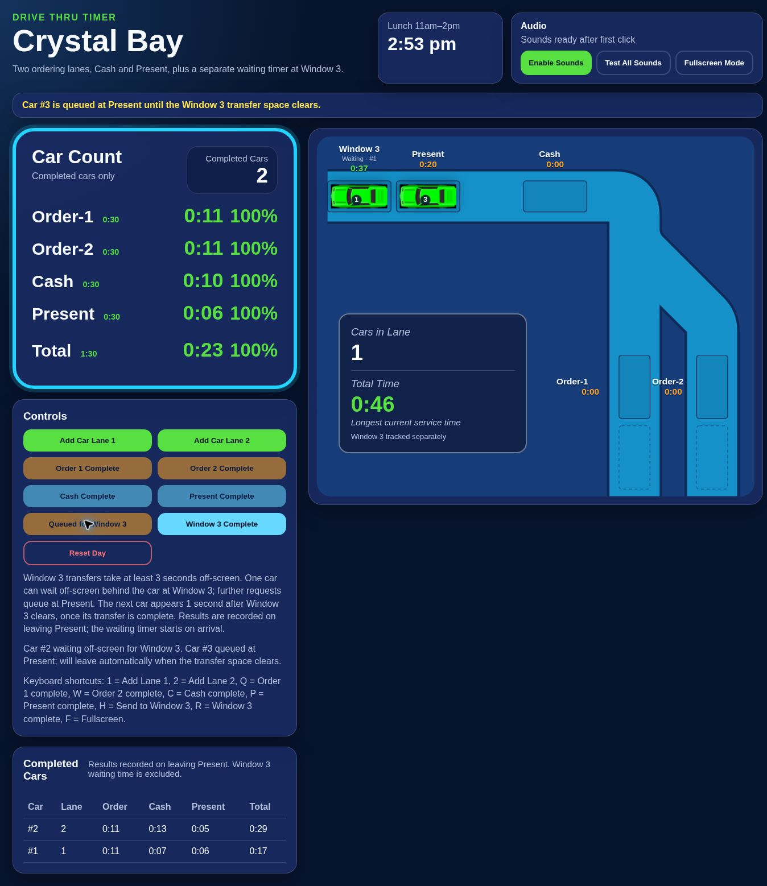

# Crystal Bay Drive Thru Timer

Static, GitHub Pages-ready timer with the original blue theme, embedded car images and sounds, results board, keyboard controls and fullscreen display.

## Layout

The map follows the Crystal Bay reference: two entry lanes on the right, a diagonal merge from Order 2, and a top road travelling left through Cash and Present to Window 3 (the Cafe position in the reference). Cars are centred on wider lanes, with station labels outside the road. The existing queue spaces and one-second movement rules are retained. Each ordering lane has a full entry space before its speaker.

## Window 3 waiting

- **Send to Window 3** queues the car at Present for transfer. It leaves on the next movement tick when the off-screen transfer space is free.
- Order, Cash, Present and Total results are recorded once, when the car actually leaves Present.
- The car disappears from Present and remains off-screen for **3 seconds** before it can appear at Window 3.
- Window 3 holds one visible car plus one car waiting off-screen. A second car can leave Present while Window 3 is occupied, then waits off-screen.
- When the current Window 3 car leaves, the off-screen car appears **1 second later**, provided its 3-second transfer has finished.
- A third car's request queues at Present until the second car reaches Window 3. It then leaves automatically on the next movement tick. Its Present and Total clocks continue while it is physically held at Present.
- The separate Window 3 timer starts at **0:00 on arrival**, with green below **1:30**, yellow from **1:30** to **1:59**, and red from **2:00** onwards. These changes are visual only.
- **Window 3 Complete** removes the visible car without recording another result.
- Transfer time and off-screen/Window 3 waiting time never contribute to service results, averages, target percentages, or live longest service time. Those cars are excluded from Cars in Lane.
- Cars leaving Present normally can bypass both waiting spaces.
- The control panel shows off-screen transfer status and requests queued at Present. Duplicate requests do not create extra transfers.
- Reloads preserve cars, queue requests, transfer delays and results. Reset Day clears the whole day.

## Controls

| Key | Action |
| --- | --- |
| 1 / 2 | Add a car to Lane 1 / Lane 2 |
| Q / W | Complete Order 1 / Order 2 |
| C | Complete Cash |
| P | Complete Present and exit normally |
| H | Send the car at Present to Window 3 |
| R | Complete Window 3 |
| F | Toggle fullscreen |

Order and Cash releases wait until the next space is free; their clocks continue until the car actually moves. Total time starts on departure from the ordering speaker and stops on departure from Present.

Fullscreen Mode uses an expanded in-page display when the browser does not grant native fullscreen. Exit Fullscreen returns to the controls.

## Targets

| Result | Target |
| --- | --- |
| Order 1 / Order 2 / Cash | 0:30 |
| Present | 0:30 |
| Total | 1:30 |

Present average colours are green below 0:30, yellow from 0:30 through 0:45, and red above 0:45. Results at or below 0:30 meet its target.

Normal car colours and total-time sounds use yellow at 1:30 and red at 2:00. Audio starts after the first interaction, subject to browser audio permissions. Use Enable Sounds or Test All Sounds if needed.

## Run and verify

Open `index.html`, or serve this directory with a static HTTP server. For GitHub Pages, deploy the root of `main`.

```sh
node --check app.js
node --check simulation.mjs
node tests.mjs
node ui-tests.mjs
```

The 20 simulation tests cover entry lanes, queue movement, merge priority, blocked stations, completion statistics, Present average colour boundaries, the 30-second Present target, Window 3 colour boundaries, exact transfer/handover delays, FIFO queueing, result isolation, normal exits, reloads at each queue phase, reset, and browser-engine parity. `ui-tests.mjs` also exercises the actual browser script, DOM rendering and button bindings without external dependencies.

## Preview


